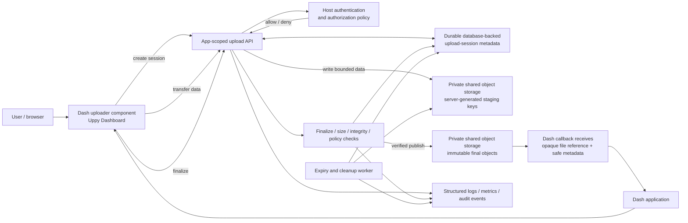

# Proposed Target Architecture

## 1. Architecture objectives

The replacement should keep the useful Dash component experience while separating presentation from the security-critical upload protocol. The target architecture must:

- scope configuration to a specific Dash/Flask app;
- bind every upload session to a server-verified authorization context;
- never turn browser-provided filenames or IDs into filesystem paths;
- enforce resource limits on the server;
- avoid exposing partial uploads as completed files;
- make retries, cancellation, expiry, and finalization deterministic;
- support a documented deployment topology and storage choice;
- return stable, minimal upload metadata to Dash callbacks.

The first-release storage profile is shared private object storage for upload data and durable database-backed metadata for upload sessions. App workers are stateless and may share that storage and metadata store. The object-storage provider, database engine, and transport service remain deployment-specific or open decisions in [the decision register](./07-decisions-risks-and-open-questions.md).

## 2. Component responsibilities

### Dash application and component

- The Python package registers an app-scoped extension/configuration object.
- The Uppy Dashboard displays file selection, restrictions, progress, and per-file state.
- The component exposes `uploadEvents` for per-file state transitions and `completedFiles` for server-confirmed results.
- Transfer progress stays in the UI instead of generating a Dash callback for every progress update.
- The component does not decide authorization or final file paths.
- Component props are treated as client-controlled input when they return to the server.

### Upload API

- Authenticates requests through the host app’s established session/auth mechanism.
- Authorizes the user for the requested operation and upload session.
- Creates upload sessions with policy-derived limits and expiry.
- Validates every request’s session, state, sequence/part, and size.
- Streams or stages data without buffering an entire large file into Python memory.
- Coordinates safe finalization and returns stable error responses.
- Does not disclose internal filesystem paths or storage credentials.

### Upload session store

Stores protocol state and metadata, not file contents. Minimum logical fields:

- opaque session reference;
- owner/authorization subject reference;
- state (`created`, `receiving`, `finalizing`, `completed`, `failed`, `cancelled`, `expired`);
- declared and received size/count metadata;
- created/updated/expiry timestamps;
- staging and final storage keys;
- integrity metadata, if required;
- structured failure code, without sensitive internal details.

Session metadata uses a durable database-backed store. It must support the selected multi-worker and restart model; in-process memory is not authoritative production state.

### Staging and final storage

- Staging keys are generated by the server and scoped to a session in private shared object storage.
- Original filename is metadata only, never a path component.
- Staged data is not exposed as complete.
- Finalization validates expected size, completeness, and any configured integrity/scanning policy.
- Final objects use immutable server-generated keys. Publication is atomic from the application's perspective by making the validated object durable before committing the completed reference and state in the session store; do not assume object-store rename is atomic.
- Cleanup is idempotent and cannot delete outside the session’s own staging area.
- Orphaned staging/final objects are reconciled against durable session state.

### Policy and authorization integration

The host application remains responsible for identifying users and deciding which users may upload. The package must provide explicit policy integration points and invoke them on every relevant lifecycle action, not only on the initial page request.

### Cleanup and operations

A bounded cleanup process removes expired/incomplete staging data and stale session records according to retention policy. Metrics and structured logs should report counts, durations, bytes, failures, and cleanup outcomes without recording file contents or credentials.

## 3. Upload lifecycle and protocol

The proposed protocol is session-oriented:

1. **Create:** authenticated client requests an upload session. Server authorizes the operation and applies configured limits.
2. **Receive:** client transfers file data using the selected transport. Server validates each request and stores only to session-scoped staging keys.
3. **Finalize:** client asks to finalize; server independently verifies that the session is complete and within policy.
4. **Publish:** server atomically publishes the file and records a completed state.
5. **Notify:** component updates Dash with an opaque completed-file reference and safe metadata. Application callbacks resolve the reference through the package/API.
6. **Expire/cancel:** abandoned or cancelled sessions transition to terminal states and cleanup is scoped and retryable.

No client event alone can mark a session complete. The server’s durable session state is authoritative.

### Transport decision

The transport is an open architecture decision because the correct choice depends on maximum file size, deployment, storage, and resumability requirements:

- **Single multipart request:** simplest but large request limits, restart behavior, and reverse-proxy handling must be explicitly accepted and tested.
- **Resumable protocol (for example, a mature tus-compatible service):** preferable where resume/retry across long transfers is required, but adds a service/protocol deployment and authorization integration.
- **Direct-to-object-storage multipart:** can reduce application-server data traffic, but requires scoped short-lived upload authorization, storage completion verification, and an object-store deployment.

Do not implement a custom chunk protocol until these options are evaluated. If custom chunking is selected, specify ordering, checksums, idempotency, concurrent request behavior, staging, cleanup, and restart persistence before coding.

## 4. Diagram

The standalone Mermaid source is in [`target-architecture.mmd`](./target-architecture.mmd).

## 5. Deployment profiles

### Profile A: single-service/local storage

The Dash/Flask app exposes the upload API and writes to a configured local or shared volume. This is the simplest profile, but it must document whether multiple workers share the same filesystem and session store. It must define proxy request limits, disk monitoring, retention, permissions, and backup expectations.

### Profile B: dedicated resumable upload service

The Dash app authorizes and creates sessions, while a dedicated protocol service receives file data. The integration must bind upload authorization to the application’s session, verify finalization in the application, and define cleanup/observability across both services.

### Profile C: direct object storage

The application authorizes a session and issues narrowly scoped, short-lived upload capability. The client sends data directly to storage. The application verifies object identity, size, multipart completion, and policy before publishing the file reference.

**Recommendation:** select one deployment profile for the first release. Do not claim support for all three until each has independent integration and security tests.

## 6. Data and trust boundaries

| Data | Trust level | Rule |
|---|---|---|
| Original filename, MIME type, browser size, component props | Untrusted | Validate and store as metadata; never use directly as a path or authorization decision. |
| Upload session reference from client | Untrusted selector | Resolve server-side and verify owner, state, and permission on every operation. |
| Authenticated principal | Trusted only after host-app verification | Use as input to policy; do not infer identity from upload ID. |
| Declared content size/checksum | Client assertion | Compare with server-observed data and configured limits. |
| Staging/final storage key | Server-generated | Keep private; scope operations to the owning session. |
| Dash callback props | Client-originated | Resolve completed references against authoritative server state. |

## 7. Error and state semantics

The API must define stable states and error codes. Suggested behavior:

- invalid request: client error with a safe machine-readable code;
- unauthenticated/unauthorized: reject without disclosing another user’s session;
- expired/cancelled session: reject data transfer and require a new session;
- quota violation: reject before accepting excess data where possible;
- transient storage failure: return retryable error only when the operation is idempotent;
- finalization failure: retain or clean staging according to a documented policy; never report completion;
- cleanup failure: log and retry; do not delete unrelated data.

Upload-trigger status in Dash should mean either “command accepted” or “upload completed”—never both. Report asynchronous success/failure through distinct props or callback events.

## 8. Architecture invariants

The following are release-blocking invariants:

1. Resolved write/delete operations cannot escape the configured storage boundary.
2. No untrusted client identifier grants access to another user’s session.
3. No frontend-only option is treated as an enforced server policy.
4. Only server-confirmed finalized sessions are visible to application callbacks.
5. Repeated operations have deterministic, tested effects.
6. App configuration is isolated across app instances and workers as specified.
7. Logs and callback data do not unnecessarily expose internal paths, credentials, or file contents.
